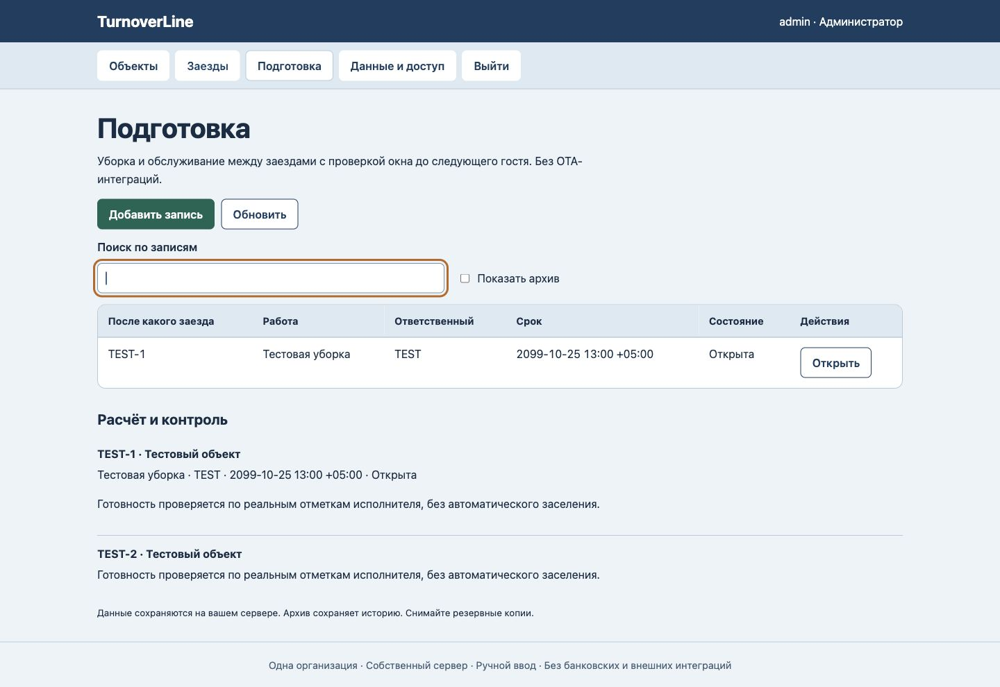

# TurnoverLine

Уборка и обслуживание между заездами с проверкой окна до следующего гостя. Без OTA-интеграций.

Самостоятельная оригинальная реализация узкого процесса. Версия 0.1.0 для одной организации на собственном сервере, с ручным вводом и проверкой человеком. Общая инфраструктура разработана для серии продуктов; предметные правила и сценарий этого проекта находятся в module.js. Это не копия исходного кода референса №77 и не его полный аналог.

## Рабочий сценарий

Администратор ведёт объекты и заезды, ставит задачи подготовки между выездом и следующим заселением. Пересечения проживания и срок подготовки вне окна отклоняются.

## Запуск

Нужен Node.js >=24.15 <25 со встроенным node:sqlite. Внешних npm-зависимостей нет.

1. Клонируйте репозиторий и перейдите в папку.
2. Задайте длинный уникальный WORK_ADMIN_PASSWORD (14–200 символов), WORK_ADMIN_USER при необходимости (по умолчанию admin). Не помещайте секрет в git.
3. Выполните npm start. Адрес по умолчанию http://127.0.0.1:8792. PORT меняет порт; PUBLIC_ORIGIN должен точно совпадать с адресом в браузере.
4. Войдите и заведите свои записи. Демонстрационные данные и пароли не включены.

Пример для локального терминала macOS/Linux:

```sh
read -r -s WORK_ADMIN_PASSWORD
export WORK_ADMIN_PASSWORD
npm start
```

Для проверки: npm test. Текущий прогон: 7 тестов, Node 24.19.0. Вывод — docs/test-output.txt, предметные положительные и отрицательные примеры — tests/scenario.json. Примеры синтетические, не данные клиентов.

## Данные и доступ

SQLite сохраняется в .data/workspace.sqlite (или DATABASE_PATH). Администратор создаёт сотрудников в «Данные и доступ». Роли ограничивают действия, но все сотрудники одной организации видят общую рабочую область: это не изоляция отделов или клиентов. Сеанс — HttpOnly/SameSite cookie, изменения — с CSRF и проверкой Origin; пароли — scrypt. Есть журнал и проверка версии записи от перезаписи устаревшим окном. Это не сертификат безопасности.

JSON-копия из интерфейса содержит рабочие данные и восстанавливается только в пустую базу того же продукта; аккаунты и журнал не переносит. Полный перенос: остановите сервер, скопируйте каталог базы целиком, включая существующие WAL/SHM, с ограниченным доступом; запустите и проверьте вход/записи. Не копируйте только основной SQLite-файл работающего процесса. Возврат: остановите сервер и используйте проверенную прежнюю копию каталога.

Публикация сервера требует отдельного HTTPS reverse proxy, собственного hostname, резервного копирования, правил хранения данных и проверки ролей. По умолчанию сервер доступен только на loopback. GitHub размещает исходный код, а не этот сервер. Не размещайте разные недоверенные приложения на одном hostname: порты не изолируют browser cookies. Для первого пилота используйте обезличенные данные. Нет reset/revoke UI для сотрудников: прекращение всех сеансов требует остановки и администрирования базы.

## Границы

Нет Booking/Airbnb/Exely, канал-менеджера, оплаты, уборочного мобильного приложения и автоматической диспетчеризации. Нет multi-tenant SaaS, внешних интеграций, платежей и подтверждённого промышленного SLA. UI на русском. Часовой пояс дат со временем выбирается явно, дневные даты без часового пояса.

Лицензия: все права сохранены; публичное чтение исходников не выдаёт коммерческую лицензию. Условия пилота/адаптации обсуждаются отдельно. Коммерческий сценарий и потенциальные компании — docs/buyers.json и docs/offer.md.

[Справка Node SQLite](https://nodejs.org/docs/latest-v24.x/api/sqlite.html) · [Предметная спецификация](PRODUCT.md) · [Проверки и ограничения](docs/verification.json)

## Вид рабочего сценария



Синтетические данные браузерной проверки, не данные или результаты клиента.

## Архивные связи: проверка25 октября2026

Новый или перенесённый заезд требует действующего объекта; новая или перенесённая подготовка — действующего заезда. Прежние связи с архивом остаются доступны для чтения и допустимых правок, выбранный источник помечен «Архив». Архивный запланированный заезд по-прежнему участвует в проверке пересечений; архив не означает отмену или фактическое проживание. Срок подготовки проверяется между выездом и следующим заездом. Ручная отметка «Выполнена» не подтверждает уборку.

[Сценарии и доказательства](docs/archive-verification.json). Семь тестов, включая файловый перезапуск и восстановление.
