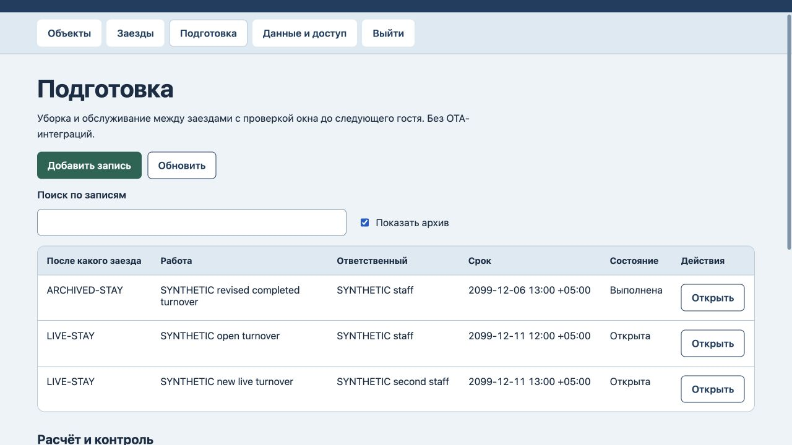

# TurnoverLine: архивные связи и история

25 октября2026. Исправлен узкий сценарий ограниченной версии0.1.

Новые и переносимые заезды больше нельзя связать с архивным объектом, а новые и переносимые задачи подготовки — с архивным заездом. Прежние записи можно читать и редактировать с исходной архивной связью: оба обязательных поля сохраняют выбранный источник с пометкой «Архив».

На прежнем коде воспроизведены шесть принимаемых сервером операций по архивам и два пустых обязательных поля браузера. Три новые регрессии сначала упали; после исправления проходят все7 тестов, включая файловый перезапуск и восстановление. Девять HTTP400 отказов сохранили все данные/версию11/журнал11: шесть новых запретов и три уже существовавшие проверки времени/пересечения.

Браузер сохранил код старого заезда и текст/срок завершённой подготовки с прежними связями и статусами. Отказ подготовки до выезда сохранил все данные/версию12/журнал12. Новая задача по действующему заезду создана; после перезагрузки3 заезда/3 задачи, версия14/журнал14. Архивный заезд, другой действующий заезд, все объекты и прежняя открытая задача не изменены. При обновлении основного процесса18 рабочих областей сохранили payload/версии/журналы.

Архив не означает отмену и не доказывает проживание. Архивный запланированный интервал продолжает блокировать пересечения; отменённый сохраняет прежнюю семантику. «Выполнена» — ручная отметка, не подтверждение уборки. Новая задача по неархивному заезду с позже архивированным объектом остаётся допустимой. Сервер проверен локально; полного нового аудита безопасности нет.

[Проверки](archive-verification.json) · [Репозиторий](https://github.com/wpalish/turnoverline)

